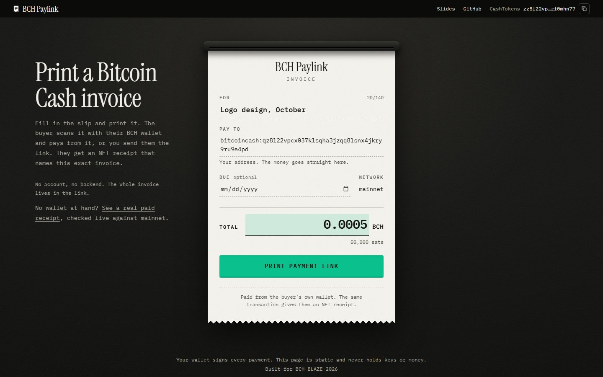
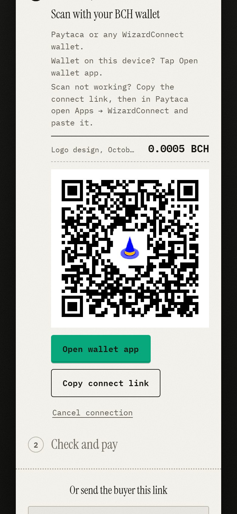
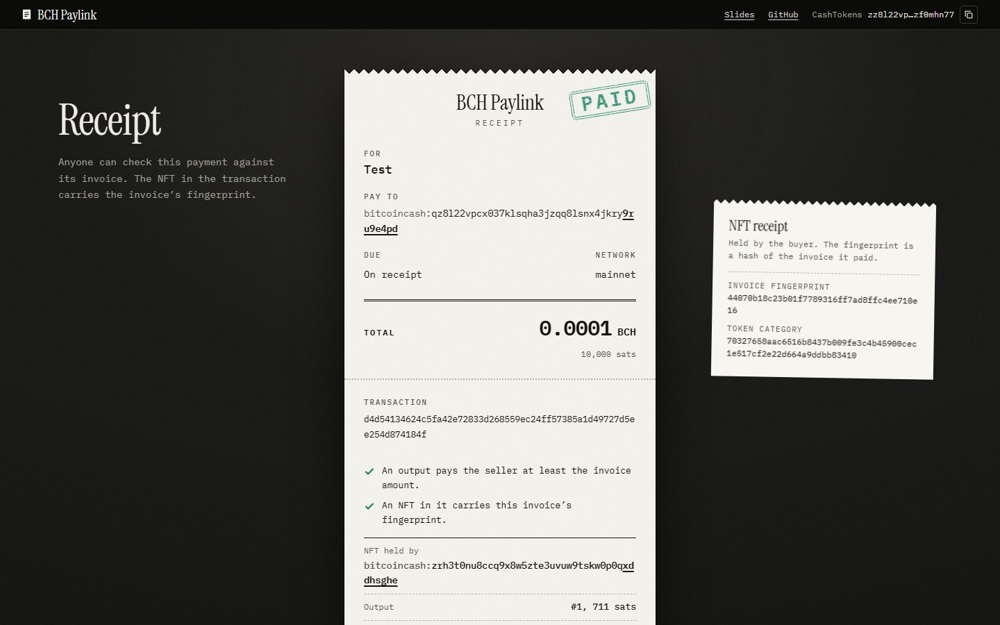
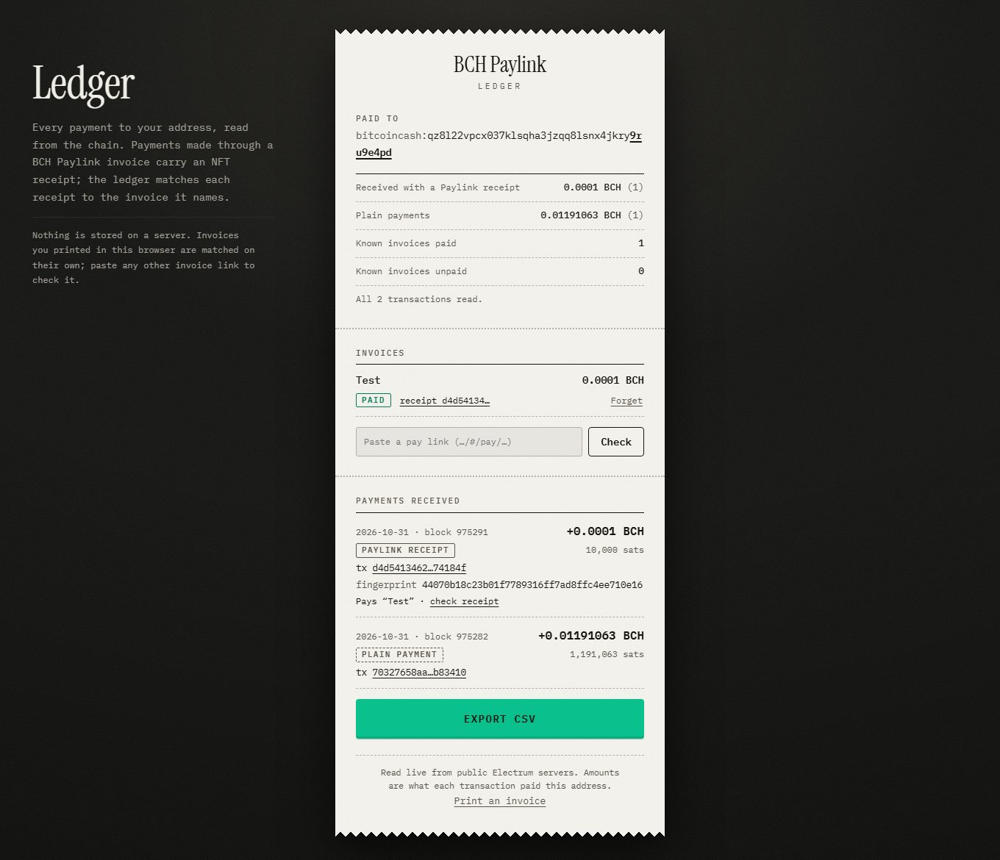

# BCH Paylink

Bitcoin Cash invoices as links. The buyer pays from their own wallet, and the same mainnet transaction mints them a CashTokens NFT receipt that names the exact invoice.

- Live app: https://runduck113.github.io/bch-paylink/
- Verified mainnet payment, checked live in the app (no wallet needed): [open the receipt](https://runduck113.github.io/bch-paylink/#/receipt/d4d54134624c5fa42e72833d268559ec24ff57385a1d49727d5ee254d874184f?inv=eyJ2IjoxLCJwYXllZSI6ImJpdGNvaW5jYXNoOnF6OGwyMnZwY3gwMzdrbHNxaGEzanpxcThsc254NGprcnk5cnU5ZTRwZCIsInNhdHMiOjEwMDAwLCJtZW1vIjoiVGVzdCIsImN1cnJlbmN5IjoiQkNIIn0)
- Same transaction on an explorer: [d4d54134…74184f on Blockchair](https://blockchair.com/bitcoin-cash/transaction/d4d54134624c5fa42e72833d268559ec24ff57385a1d49727d5ee254d874184f)
- Slides: [BCH BLAZE 2026 deck](https://docs.google.com/presentation/d/1b6KO1aTGUeWA0oWCafc7ZTAp0i3hFmOKYymTJ6YXZTI/edit?usp=sharing)
- Built for BCH BLAZE 2026, Mainnet Track. Project CashTokens address: `bitcoincash:zz8l22vpcx037klsqha3jzqq8lsnx4jkryzf0mhn77`

| Seller fills in the slip | Buyer scans with their wallet | Anyone checks the receipt |
| --- | --- | --- |
|  |  |  |

## Try it in 60 seconds

1. Open https://runduck113.github.io/bch-paylink/.
2. No wallet at hand: click **See a real paid receipt** under the intro. The page fetches the real mainnet transaction, recomputes the invoice fingerprint, and shows two green checks and a PAID stamp. Then click **that seller’s ledger**: every payment to the seller’s address, with the Paylink receipt picked out from the plain payments. Paste the [demo pay link](https://runduck113.github.io/bch-paylink/#/pay/eyJ2IjoxLCJwYXllZSI6ImJpdGNvaW5jYXNoOnF6OGwyMnZwY3gwMzdrbHNxaGEzanpxcThsc254NGprcnk5cnU5ZTRwZCIsInNhdHMiOjEwMDAwLCJtZW1vIjoiVGVzdCIsImN1cnJlbmN5IjoiQkNIIn0) into its Invoices box and the "Test" invoice shows as PAID.
3. With a wallet: fill in the slip (your own `bitcoincash:` address, an amount such as `0.0001`, a memo) and press **Print payment link**. The slip shows a WizardConnect QR at once.
4. Scan it with Paytaca (or paste the connect link into Paytaca under Apps, WizardConnect). Check the amount, approve in the wallet, then open the receipt.

Paying yourself costs only the network fee (a few hundred sats) plus 711 sats that stay with you in the NFT output.

## Who it’s for

Freelancers and small shops that invoice in BCH and need to know which invoice a payment was for.

**Why not just paste an address?** A bare address tells you that money arrived, not what it was for. Two customers paying the same amount on the same day look identical, and a memo in a chat message is not on chain. With a Paylink invoice, each payment carries an NFT whose commitment is a hash of that exact invoice. The seller gets an on-chain ledger that matches payments to invoices without a server, and the buyer keeps a proof of payment they can show later.

**Business model (plans, not built).** The core stays free and static: invoices, payment, receipts, the ledger. Paid hosted extras could cover what a static page cannot: branded receipts and invoice pages, recurring invoices, and accounting export integrations (Xero, QuickBooks and similar) beyond the CSV the app already exports.

## How it works

**One transaction does both jobs.** The buyer's transaction has three outputs: the payment to the seller, a new CashTokens NFT to the buyer's first receive address, and change. The NFT is a genesis in that same transaction, so its token category is the txid of the coin spent as input 0. CashTokens only allows genesis from a coin that was output 0 of its own transaction; if the wallet has none, the app first offers a small self-send ("Prepare wallet").

**The NFT commitment is the invoice fingerprint.** The commitment is the first 20 bytes of sha256 over a canonical JSON form of the invoice (fixed key order, lowercase payee, `sats` as a string, `due` only when set). See `src/lib/receipt.ts`. Anyone holding the invoice link can recompute it and compare it with the NFT on chain.

**The invoice lives in the link.** The pay link is `#/pay/<base64url JSON>`. Nothing is stored anywhere. Links are size-capped and validated when opened (address network, dust limit, memo length, date).

**WizardConnect pairing, the wallet signs.** The page shows a WizardConnect QR and an open-in-wallet link. The wallet shares the xpubs of its receive and change chains; the app derives the first 20 addresses of each, reads their coins from a public Electrum server, builds the transaction, and sends it to the wallet unsigned with `inputPaths` so the wallet knows which key signs which input. The app asks the wallet not to broadcast, checks that the wallet only added signatures, then broadcasts the signed transaction itself. If a broadcast result is unclear, it only ever resends the same transaction, never a new one.

**The seller’s ledger.** `#/ledger?addr=<seller address>` reads the address history from Electrum, then each transaction. A transaction counts as a Paylink payment when one of its outputs is an NFT with a 20-byte commitment whose token category equals the txid of input 0, which is how the app mints receipts. Invoices printed in this browser are remembered in localStorage; any other invoice can be pasted as a pay link. For each known invoice the page computes the fingerprint and marks it PAID (a receipt carries it and the same transaction pays the seller at least the amount) or UNPAID. Receipts for invoices this browser doesn’t know are listed too. Totals at the top, 50 transactions at a time with "load more", and a CSV export for accounting. The logic is in `src/lib/ledger.ts`.



**Static site, no custody.** No backend of ours, no accounts, no keys. The page never holds funds.

## Verify the mainnet payment yourself

Transaction `d4d54134624c5fa42e72833d268559ec24ff57385a1d49727d5ee254d874184f` (block 975291, paid with Paytaca over WizardConnect). Outputs: #0 pays 10,000 sats to the seller `bitcoincash:qz8l22vpcx037klsqha3jzqq8lsnx4jkry9ru9e4pd`, #1 is the 711-sat NFT receipt to the buyer, #2 is change. Fee 315 sats.

1. In the app: open the [receipt link](https://runduck113.github.io/bch-paylink/#/receipt/d4d54134624c5fa42e72833d268559ec24ff57385a1d49727d5ee254d874184f?inv=eyJ2IjoxLCJwYXllZSI6ImJpdGNvaW5jYXNoOnF6OGwyMnZwY3gwMzdrbHNxaGEzanpxcThsc254NGprcnk5cnU5ZTRwZCIsInNhdHMiOjEwMDAwLCJtZW1vIjoiVGVzdCIsImN1cnJlbmN5IjoiQkNIIn0). The page reads the raw transaction from Electrum, parses it in the browser and checks it against the invoice in the link.
2. By hand, without the app. The invoice in that link, in canonical form, hashes to the commitment:

   ```sh
   printf '%s' '{"v":1,"payee":"bitcoincash:qz8l22vpcx037klsqha3jzqq8lsnx4jkry9ru9e4pd","sats":"10000","memo":"Test","currency":"BCH"}' | sha256sum | cut -c1-40
   # 44070b18c23b01f7789316ff7ad8ffc4ee710e16
   ```

3. The same 20 bytes are in the NFT output of the raw transaction:

   ```sh
   curl -s https://api.blockchair.com/bitcoin-cash/raw/transaction/d4d54134624c5fa42e72833d268559ec24ff57385a1d49727d5ee254d874184f | grep -o 44070b18c23b01f7789316ff7ad8ffc4ee710e16
   ```

   The token category is `70327658aac6516b8437b009fe3c4b45900cec1e517cf2e22d664a9ddbb83410`, the txid of the coin spent as input 0.

## Tech stack

- TypeScript, React 19, Vite. Static build on GitHub Pages, hash routing.
- `@wizardconnect/react` and `@wizardconnect/dapp` for wallet pairing and signing requests.
- `@bitauth/libauth` for HD derivation, transaction building, CashTokens encoding and verification.
- `cashscript`'s `ElectrumNetworkProvider` for reading coins and broadcasting (no contracts).
- Vitest: 175 tests over the pure logic (invoice codec and validation, commitment, output planning and fees, HD paths, receipt parsing, broadcast error classification, ledger receipt detection, invoice matching, CSV).

## Limitations

- Paying needs a WizardConnect wallet; it was tested with Paytaca only.
- "No backend" does not mean no third parties: pairing goes through the WizardConnect relay, and coin lookups and broadcasts go through public Electrum servers.
- The receipt proves that an output paid the seller at least the invoice amount and that an NFT in the same transaction carries the invoice fingerprint. It does not prove who paid, and anyone holding the link could make a matching NFT in another transaction (which would still have to pay the seller).
- Only the first 20 receive and 20 change addresses of the wallet are scanned.
- First-time buyers may need the extra "Prepare wallet" self-send before the NFT can be minted.
- Amounts are in BCH only; there is no fiat price or stablecoin invoice yet.
- The ledger only knows invoices printed in this browser or pasted into it; another browser starts with an empty list. It reads public chain data for one address at a time. It trusts the Electrum server for the history and block heights (no SPV proof), and a server could leave transactions out.
- The "already paid" warning on the pay page lives in the buyer's browser only.
- Hackathon build, not audited. One real mainnet payment so far. Do not use it for amounts you care about.

## Roadmap

- Stablecoin invoices (PUSD or another CashTokens stablecoin).
- Recurring and partial payments against one invoice.
- Accounting formats beyond CSV and receipts as proof of purchase for refunds and warranties.

## Run locally

```sh
npm install
npm run dev        # chipnet by default
npm test           # vitest
npm run build      # mainnet by default; output in dist/
npm run preview
```

Set `VITE_NETWORK=mainnet` or `VITE_NETWORK=chipnet` to choose the network. Unset means chipnet in `vite dev` and mainnet in `vite build`. The production build uses the base path `/bch-paylink/`; `.github/workflows/pages.yml` runs the tests, builds and deploys on every push to `master`. Banner links and the project CashTokens address are in `src/config.ts`.

## License

MIT, see [LICENSE](LICENSE).
